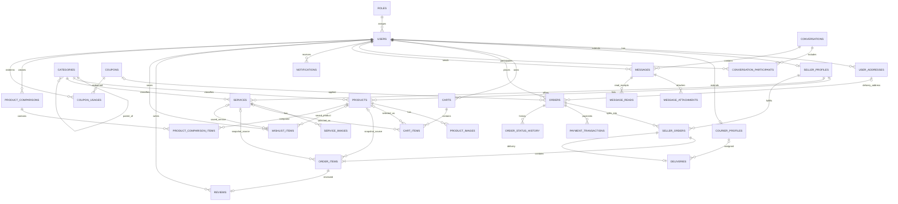

# Afghan Connect – Main ERD

## How the important flow works

1. A customer has a cart. Each cart line references one product or one service.
2. At checkout, the backend recalculates prices and creates one parent `orders` record.
3. The backend groups cart lines by seller and creates one `seller_orders` record per seller.
4. Each seller order receives its own `order_items` and delivery record.
5. A courier can be assigned to each seller order's delivery.
6. Status changes are written to `order_status_history`.
7. Chat messages are stored in PostgreSQL and broadcast through Socket.IO.
